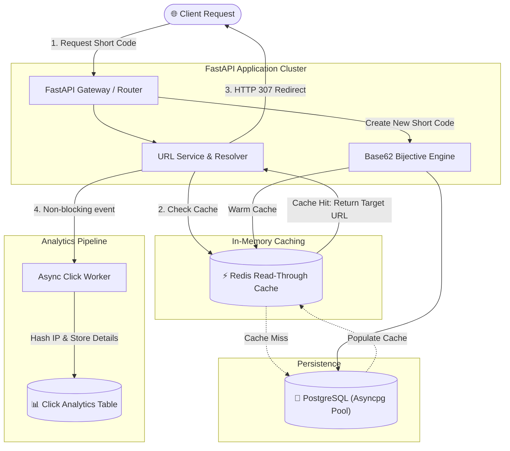

# 🔗 Scalable URL Shortener

[](https://github.com/MSBHOSLE/scalable-url-shortener/actions)
[](https://fastapi.tiangolo.com)
[](https://www.python.org/)
[](https://www.postgresql.org/)
[](https://redis.io/)
[](https://www.docker.com/)
[](LICENSE)

A production-grade, high-throughput distributed URL shortening service built with **FastAPI**, **Redis**, and **PostgreSQL**. Engineered with custom **Base62 bijective encoding**, **Read-Through caching**, and non-blocking asynchronous click analytics.

---

## 🏗️ Architecture Overview



---

## ⚡ Key Engineering Highlights

1. **Bijective Base62 Encoding Engine**:
   - Maps auto-incrementing database sequence IDs into compact, URL-safe 6-character strings (`[0-9a-zA-Z]`).
   - Generates up to **$62^6 = 56,800,235,584$** unique, collision-free short codes without brute-force random hash retries.
   - Built-in offset masking prevents predictable enumeration of sequential identifiers.

2. **Read-Through In-Memory Caching (Redis)**:
   - High-speed resolution delivers **sub-millisecond latency** for popular links.
   - Cache hits bypass the relational database entirely.
   - Transparent write-through cache warming on creation and immediate cache eviction on updates/deletions.

3. **Privacy-Preserving Click Analytics**:
   - Asynchronously captures click counts, referrers, and user agents without blocking the redirect response.
   - Hashes client IP addresses using **SHA-256** to ensure GDPR and privacy compliance.

4. **Fault Tolerance & Graceful Degradation**:
   - Automatically falls back to PostgreSQL querying if the Redis cache instance is temporarily unreachable.
   - Connection pooling managed via `SQLAlchemy 2.0` async engine and `asyncpg`.

---

## 📡 API Reference

### Core Endpoints

| Method | Endpoint | Description | Status Code |
| :--- | :--- | :--- | :--- |
| `POST` | `/api/v1/urls` | Shorten a target URL (with optional custom alias & TTL) | `201 Created` |
| `GET` | `/{short_code}` | Redirect to destination URL (Read-Through Cache) | `307 Temporary Redirect` |
| `GET` | `/api/v1/urls/{short_code}` | Retrieve short URL metadata and lifetime clicks | `200 OK` |
| `GET` | `/api/v1/urls/{short_code}/analytics` | Get 24-hour click breakdown and top referrers | `200 OK` |
| `PATCH` | `/api/v1/urls/{short_code}` | Update active status or expiration date | `200 OK` |
| `DELETE` | `/api/v1/urls/{short_code}` | Delete short link and invalidate cache | `204 No Content` |
| `GET` | `/api/v1/health` | Service, PostgreSQL, and Redis health probes | `200 OK` |

---

## 🚀 Quickstart with Docker Compose

The fastest way to spin up the complete stack (FastAPI, Redis, PostgreSQL):

```bash
# 1. Clone repository
git clone https://github.com/MSBHOSLE/scalable-url-shortener.git
cd scalable-url-shortener

# 2. Start services in background
docker compose up -d --build

# 3. Verify health status
curl http://localhost:8000/api/v1/health
```

Interactive Swagger documentation is available at:
👉 **[http://localhost:8000/docs](http://localhost:8000/docs)**

---

## 💻 Local Development Setup

```bash
# Create and activate virtual environment
python3 -m venv .venv
source .venv/bin/activate

# Install dependencies
pip install -r requirements.txt
pip install -e ".[dev]"

# Copy environment variables
cp .env.example .env

# Run FastAPI development server with hot-reload
uvicorn app.main:app --reload --port 8000
```

---

## 🧪 Testing

Run unit tests and integration tests using `pytest`:

```bash
# Run test suite
pytest -v

# Run with coverage report
pytest --cov=app tests/
```

To run the standalone Base62 unit test suite:
```bash
python3 -m unittest tests/test_base62_unittest.py
```

---

## 📊 Benchmarking & Load Testing

A high-concurrency benchmark script is included under `scripts/benchmark.py`:

```bash
# Run 1,000 concurrent requests against read-through cache
python3 scripts/benchmark.py
```

---

## 👤 Author

**Mahesh Sanjayrao Bhosle**
- **GitHub:** [@MSBHOSLE](https://github.com/MSBHOSLE)
- **LinkedIn:** [Mahesh Bhosle](https://linkedin.com/in/mahesh-bhosle-916991198)
- **Email:** msbhosle.2@gmail.com
- **Education:** M.Sc. Data & Computer Science, Heidelberg University

---

## 📄 License

This project is licensed under the MIT License - see the [LICENSE](LICENSE) file for details.
